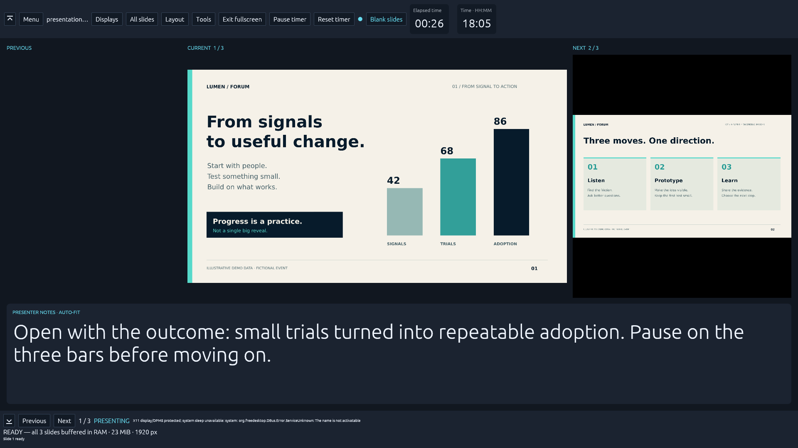
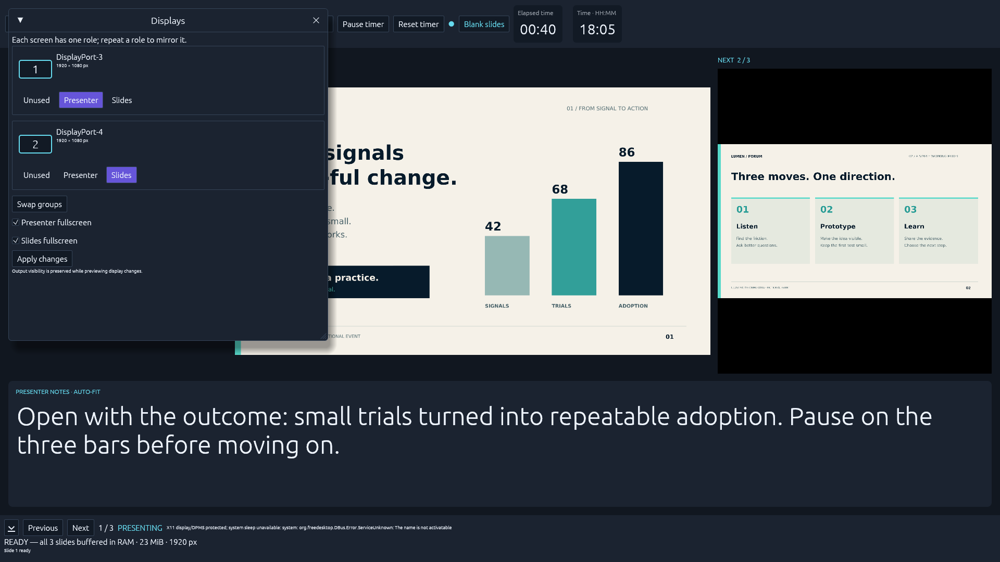
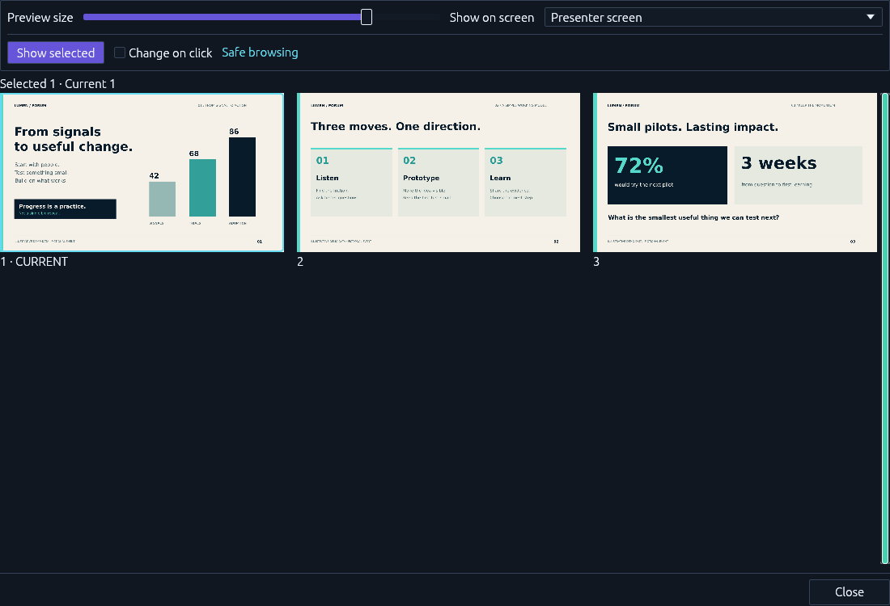
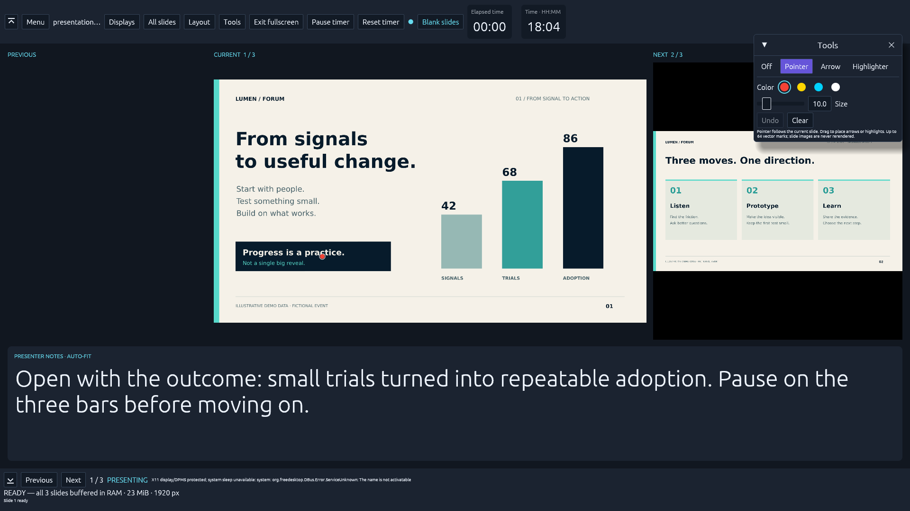

<p align="center">
  
</p>
<h1 align="center">PDF Presenter</h1>
<p align="center"><strong>A fast, portable presenter for PDFs and picture folders.</strong></p>
<p align="center">Fullscreen slides for the room. Notes, previews and controls for you.</p>

<p align="center">
  <a href="docs/changelog.md"></a>
  <a href="docs/development/ci.md"></a>
  <a href="docs/development/ci.md"></a>
</p>

<p align="center">
  <a href="https://proxy.dandaedre.com/gitea/idle-org/pdf-presenter/releases"><strong>Download PDF Presenter</strong></a> ·
  <a href="docs/user-guide.md">User guide</a> ·
  <a href="https://proxy.dandaedre.com/gitea/idle-org/pdf-presenter/issues">Report an issue</a>
</p>

PDF Presenter gives each connected screen a job: **Presenter**, **Slides**, or
**Unused**. Keep the current slide, next slide, notes and timers in front of you
while one or more other screens show only the presentation. You can also mirror the
Presenter view, rehearse on one monitor, or change the arrangement during a session.

<p align="center">
  
</p>

The application is built around a simple requirement: advancing a slide should feel
immediate. Prepared slides are buffered in RAM, reusable processed images make a
second opening faster, and large decks use a rolling buffer instead of exhausting
memory. Rendering, notes and file work run outside the presentation controls so a
slow document operation does not have to freeze navigation.

## What it does well

| Feature | What it means while presenting |
| --- | --- |
| **Real multi-screen control** | Assign Presenter or Slides to every connected monitor. Repeat either role across several screens. Display changes use a confirmation timer and revert if the new arrangement is wrong. |
| **Layouts for each Presenter screen** | Resize or hide the current slide, next slide, previous slide, notes, timers and progress bar. Save a layout for one project or as a default, with separate preferences for different screens. |
| **Fast, visible preparation** | The Presenter reports what it is preparing, RAM use and an ETA when available. Prepared nearby slides are served from RAM; a bounded rolling buffer reloads distant slides only when needed. |
| **Useful live tools** | Point, draw arrows and highlight without modifying the PDF or rerendering slide images. Tool size follows the visible slide, including high-resolution output. |
| **Shared zoom** | Opt in to zoom, pan or fit a page to width from Presenter or Slides. Both views stay on the same part of the page. |
| **Safe slide browsing** | Browse resizable thumbnails without changing the live slide. Double-click to preview, or enable **Change on click** when direct switching is useful. |
| **Notes that belong to the presentation** | Read notes from a sidecar or the PDF, import TXT/Markdown, and double-click the notes pane to edit the current slide. Notes automatically fit the available space. |
| **Presentation-aware desktop behavior** | PDF Presenter asks supported operating systems to keep the display awake and reports whether protection is active. Closing Presenter also closes its Slides windows. |
| **Portable by design** | The release binaries include the PDF renderer and application dependencies. Keep the extracted folder anywhere convenient; no Rust or separate PDF software is required. |

On Windows, multi-screen output, per-screen layouts, zoom, tools, and unplugging then
reconnecting displays have been tested in extended use. Linux and macOS use the same
presentation model, but desktop and window-manager behavior still deserves testing
on the machines that will run the show.

## Download and run

Open the [release page](https://proxy.dandaedre.com/gitea/idle-org/pdf-presenter/releases)
and download the archive for your computer.

| Platform | Recommended download | Start after extracting |
| --- | --- | --- |
| Windows x86_64 | `pdf-presenter-portable-x86_64-pc-windows-gnu-v….zip` | `pdf-presenter.exe` |
| Linux x86_64 | `pdf-presenter-portable-x86_64-unknown-linux-gnu-v….tgz` | `./pdf-presenter` |
| Apple Silicon macOS 13+ | v0.1.83 `pdf-presenter-aarch64-apple-darwin-v….tgz` | Follow the release-page instructions for the unsigned executable |

Windows and macOS builds are currently unsigned. Releases are previews, so test the
actual computer, adapters and display arrangement before a live event. The macOS
artifact is a one-off cross-build in v0.1.83 and has not yet had native Mac runtime
testing. [Installation and update details →](docs/user-guide.md#install-and-update)

If you already have [cargo-binstall](https://github.com/cargo-bins/cargo-binstall)
installed, you can install a prebuilt release directly:

```sh
cargo binstall pdf-presenter --git https://proxy.dandaedre.com/gitea/idle-org/pdf-presenter --version 0.1.83 --strategies crate-meta-data
```

Replace `0.1.83` with the published version you want from the release page. This
uses the repository's release archives and requires an available build for your
platform. Then run `pdf-presenter`.

## Set up a show

1. **Open a PDF or picture folder.** Use Menu, drag and drop, or open an associated
   PDF on Windows. Pictures follow natural filename order.
2. **Choose where each view goes.** Open **Displays**, select Presenter, Slides or
   Unused for each monitor, then apply the change. Keep the proposal or let it revert.
3. **Arrange your Presenter view.** Open **Layout** to size and position slides,
   notes, clocks and progress. Save it for this presentation or for all projects.
4. **Present.** Use Left/Right, Page Up/Page Down or Space. Type a slide number and
   press Enter to jump directly to it. Press B to blank or restore Slides.

PDF Presenter shows Slides by default after a document opens. Entering or leaving
fullscreen and changing screen assignments preserve that choice. Header and footer
controls can auto-hide; move the pointer near their edge or right-click to recover
them.

<table>
  <tr>
    <td width="50%"></td>
    <td width="50%"></td>
  </tr>
  <tr>
    <td align="center"><strong>Route and mirror screens</strong></td>
    <td align="center"><strong>Browse without disturbing the live slide</strong></td>
  </tr>
</table>

## Zoom and point while presenting

Enable page zoom from Menu when a document needs it. Scroll to zoom, drag to pan,
and double-click to fit the page width or reset. The crop is shared with Slides and
uses the already buffered image.

Open **Tools** for a pointer, arrows and a highlighter. Marks remain vector overlays
on the current slide and can be undone or cleared instantly. Their apparent size is
scaled between the smaller Presenter preview, 1080p output and 4K output.

<p align="center">
  
</p>

## Slides, notes and shortcuts

PDFs work directly. A picture folder becomes a deck using natural filename order;
for example, `slide_2.png` comes before `slide_10.png`. Notes may come from embedded
PDF annotations, a `.notes.toml` sidecar, per-slide text files, or imported TXT and
Markdown. Source slides and imported note files are not overwritten.

Useful controls:

- **Right / Space** — next slide
- **Left / Shift+Space** — previous slide
- **Number, then Enter** — jump to a slide
- **B** — blank or restore Slides
- **P / A / H** — pointer, arrow or highlighter
- **Escape** — cancel the current popup or display proposal; fullscreen has its own button

[Notes, layouts and controls →](docs/user-guide.md) ·
[Notes file formats →](docs/interfaces/presentation-notes.md) ·
[Preparation, cache and RAM behavior →](docs/user-guide.md#preparation-processed-slides-and-ram)

## Open source

PDF Presenter is independent open-source software under the [MIT license](LICENSE).
Development includes LLM-generated or LLM-assisted work with human review. The
project is used in professional settings, while preview limitations and physical
acceptance work remain documented rather than hidden.

---

[Development and source builds](docs/development/README.md) ·
[Changelog](docs/changelog.md) · [MIT license](LICENSE) ·
[More beffroi tools](https://proxy.dandaedre.com/gitea/Beffroi/beffroi-tools)
